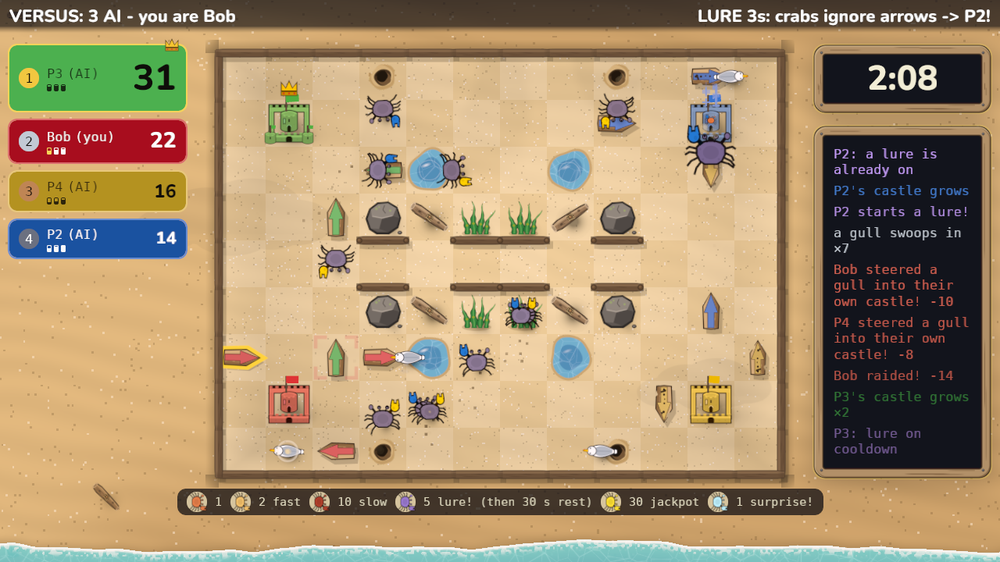
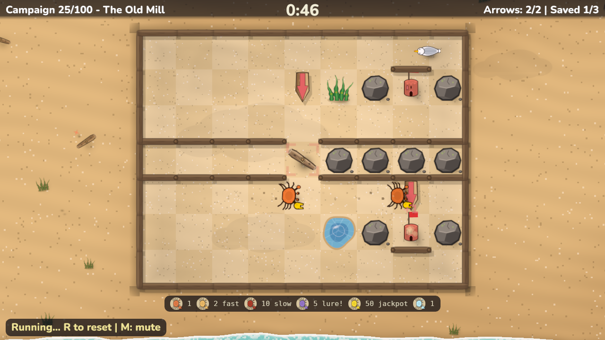
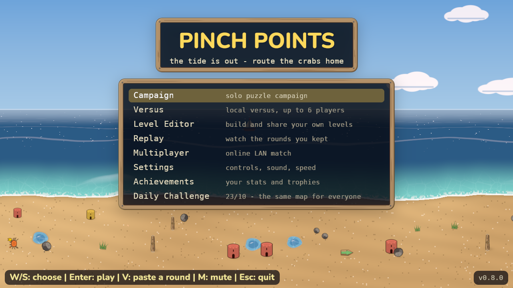
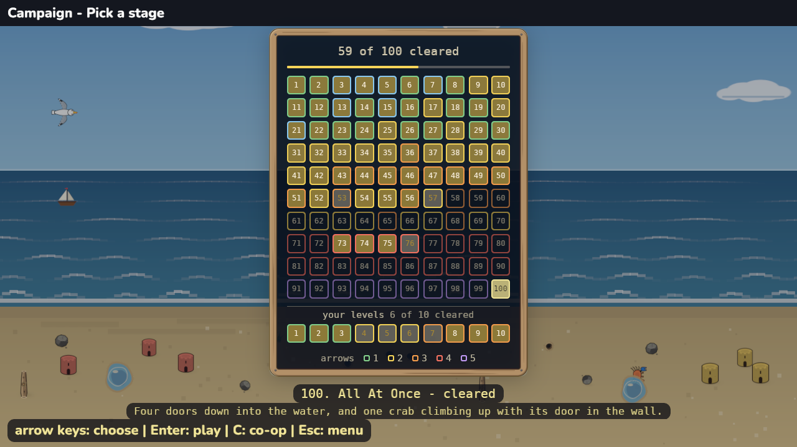

# Pinch Points: the guide

Everything past the [README](../README.md): where the game comes from, the
full rules, what each mode holds, every control and setting, and the
development hooks.

- [Lineage](#lineage)
- [What's different](#whats-different)
- [Rules](#rules)
- [Modes](#modes)
- [Controls](#controls)
- [Settings and languages](#settings-and-languages)
- [Building and running](#building-and-running)
- [Determinism](#determinism)
- [Tooling](#tooling)

## Lineage

Pinch Points is built on the mechanical skeleton of Sonic Team's **ChuChu
Rocket!** (1999):

| ChuChu Rocket | Pinch Points |
|---|---|
| Mice (ChuChus) | Crabs |
| Cats (KapuKapus) | Gulls |
| Rockets | Sandcastles |
| Arrow panels | Arrows |
| "?" roulette specials | Random events |
| Cat Mania / Mouse Mania | Gull Mania / Crab Mania |
| Wrap-around edges | Open-ocean levels |

Inherited: creatures walk forward and turn at walls by a fixed rule, arrows
are the player's only verb, everyone places simultaneously in versus, and
steering the predator is as much fun as steering the prey.

## What's different

**Six players, not four**, at four corner castles plus two mid-edge on the
wider generated arenas. Team play grows with the table: 2v2 at four, 2v2v2
or 3v3 at six. Which castle is whose is drawn each round on a generated
arena, and on the classic map at three, so the spot an odd table leaves
worst off is nobody's for good; three players get the four end spawner
holes, and five take the four corners and one long edge (on the open
ocean, both long edges and three corners).

**Every crab has a handedness.** The original's turn rule is global; here
left-clawed crabs try left first and right-clawed right, with the oversized
claw as the tell. One bit of state that turns herding puzzles into *sorting*
ones: the same corridor routes two crabs to two destinations.

**The score is on the board.** Castles grow through four tiers as they
score; the HUD is the redundancy, not the readout.

**A raid costs a third, and hands some back.** A gull carries off a third
of the castle's score, spills live crabs onto the sand for everyone to scramble
over, and leaves with its loot: a raid drains the flock instead of
compounding it.

**The tide, instead of a rocket launch.** The sea closing in around the
board is the visible clock. The last 30 seconds double the gull spawn rate;
the wave stops everything where it stands.

Plus terrain and a crab bestiary the original never had, AI that walks a
cursor to the tile the way you do, replays shareable as text codes (even a
round *in progress*), a daily challenge that needs no server because the sim
is deterministic, and an editor whose solver proves a level beatable before
it ships.

## Rules

**The sand.** A walled grid. Crabs and gulls walk forward; at a wall they
turn toward their claw side, then the other side, then back the way they
came.

**Arrows.** Your one verb: every creature crossing one turns that way.
In versus you may have **3** standing by default (the match setup and the
lobby both set it, from 1 to 6; one past it replaces your oldest), each
washes away after ~10 seconds, and two gull crossings destroy one.

**Crabs** stream out of spawner holes and score by walking into any
castle. By value/speed: common (1), juvenile (2, fast), giant (10, slow),
molting (5; scoring one **lures every loose crab toward your castle for
5 s, overriding all arrows**), golden (fast: 30 in versus, 50 in
puzzles), and sparkling
(scoring one spins the **random event** roulette: crab/gull manias, speed
shifts, castle swaps, fresh sand…). The banner and the event feed say
whose crab started it. Speed Up also opens the crab holes twice as often,
and a castle swap with three castles or more leaves the castle of whoever
started it alone. While a timed event is still running, the top of the
event feed counts down its seconds left, the roulette is on cooldown, and
the feed says so when a sparkling crab is scored for nothing.

**The golden crab is called.** It never just wanders out: once a round
(twice in a long one, never in a one-minute one) a banner announces it, and one spawner hole swells
and pulses gold for five seconds before the golden crab comes out of it.
Everyone sees it coming, so it goes to whoever routes it home first.

**Gulls** eat crabs on contact and are steerable: aiming them at a rival's
castle is the entire offensive game. A gull reaching a castle **carries off
a third of its score** and departs. Gulls occasionally take flight for a few
tiles, ignoring walls and arrows, so no corner is ever fully safe. The
flock keeps moving: when it is full, the oldest gull away from the castles
flies off and a fresh one arrives from the edge, so birds circling where
they can hurt nobody do not hold the beach for the rest of the round.

**Castles are the scoreboard**, flanked by a ranked leaderboard on the left
(the leader's card is biggest and wears the crown) and the tide clock over a
live event feed on the right. A lure, a random event or the final gull rush is
announced across the centre of the screen as well.



**The clock.** It turns red for the last 30 seconds, the gulls arrive
twice as fast and the flock can grow by half; when time is up, the highest score wins. The results
card also hands out the round's awards, for the comeback from furthest
behind, the lure that paid most, the most arrows planted and the most
score lost, so the rest of the table has something to point at too.

**Terrain.**



- **Turnstile log**: deflects each crossing creature right or left,
  alternating: a deterministic 50/50 splitter.
- **Kelp**: crabs slip through; gulls can neither walk nor land in it.
  Build gull-proof supply lanes.
- **Tide pools**: shallow water; wading halves your speed.

## Modes



- **Campaign**: a 100-level solo puzzle campaign with a fixed arrow
  inventory. The test suite proves every level solvable with the arrows it
  grants and unsolvable without them; the opening tutorial is the exception,
  handing you one to practise with on a board that cannot be lost.
  Press **C** on the stage list for **co-op**: a second player joins on the
  second seat's keys or a pad, and the two of you share the stage's arrows,
  either of you free to put one down, turn it or pick it up. Every Tide
  Pool stage plays the same with two as with one, so all hundred are open
  to it. For stages that need two, see Co-op.
- **Co-op**: a shelf of stages for two players, easiest first, on the
  stage list below the Tide Pool (marked **2P**). Each player has their
  own arrows, and **your
  arrows turn only crabs with your claw**: P1's turn the left-clawed
  crabs, P2's the right-clawed ones, and a crab of the other claw walks
  straight over them. On these stages each crab's big claw is drawn in
  the colour of the player who steers it, the colour of that player's
  arrows. Gulls turn on anybody's
  arrow. A tile still takes one arrow, and only its owner can turn or lift
  it, so the two plans meet on the sand: often one of you has to give way.
  Each arrow carries a small crab showing the claw it turns. Press **C**
  first to seat P2; a co-op stage will not start with one player. The test
  suite proves each stage needs both: neither player wins it alone with
  every arrow, and arrows that turned every crab would not win it either.
  The editor's **Players** row makes a stage of your own for two.
- **Versus**: local versus for **2-6 players** on one keyboard plus
  gamepads. Eighteen built-in maps: the handcrafted classic map, eleven
  more handmade maps each built around one idea, generated arenas up to
  20×13, an edgeless **open ocean**, and **Surprise** (five players need
  a generated map 16 tiles across or more, the open ocean included,
  Surprise, or Gull Road, built for five; six can also play Round Table,
  Round the World and Back to Back, built for two, four or six), plus any
  map you built yourself that has a castle for every player. The
  handmade maps are **The Gates** (each castle in a kelp hedge with one
  gate, the only way a gull walks in), **The Moat** (each castle in a
  pond with a dry jetty), **Log Jam** (every hole feeds a log that deals
  its crabs to two castles in turn), **Three Lanes** (two sea walls cut
  the beach into lanes), **Round Table** (six castles, a wall behind
  each corner, so the edge ones win as often as the corners), **Round the World** (no edges: three
  strips of beach, every castle a copy of the others), **Duel** (for
  two), **The Fountain** (all four holes sit in a pond in the middle, so
  the crabs wade out slowly, and no arrow stands in water), **Four
  Doors** (for three, no edges: each castle stands in walls with a door
  on every side, the only way in for crabs and gulls alike), **Gull
  Road** (for five, no edges: gulls land only on a road along the top
  and bottom, kelp keeps them on it, and two gates lead from it to each
  castle) and **Back to Back** (no edges: the castles stand back to back
  in pairs, a wall between them). Each seats the tables it was balanced for: two or four players,
  Round Table, Round the World and Back to Back six too, Duel two, Four
  Doors three and Gull Road five. Those two are open beaches of
  identical strips with a castle in each, so no castle is left empty and
  none is better placed than another; elsewhere an odd table plays a
  generated map, because a castle left empty on a fixed layout hands the
  castle across from it the round. **Surprise** generates a new map
  every round in one of five styles (a braided maze, logs strewn about,
  islands crossed by sand bridges, a lagoon with a kelp shore, or long
  sea walls in lanes, lanes only up to four players), drawn from the
  round's seed. **Every round's map is mirrored** left-right and/or
  top-bottom at random from its seed (an edgeless handmade map is also
  rolled round by a whole strip), and a handmade map deals its castles
  to the players in opposite pairs, so team play keeps its partners
  across from each other: the sim and the AI favour one diagonal by a few
  points, and the mirror spreads that over every castle. A map you built
  yourself is played as you drew it. A
  generated map follows the table as players sit down: the 9×7 for two,
  12×9 for three or four, 16×11 for five or six, and 20×13 only when you
  pick it. The bigger maps get more walls and more gulls for their size,
  so a big beach plays as busy as a small one. Dials for
  how many gulls and round length, **team play**, a **best of 3 or 5**
  series with rotating maps and nameable seats. AI comes at three levels:
  easy fumbles, fierce reads the terrain and shoves gulls at the leader, and
  all three walk a cursor at a capped speed rather than reaching across the
  board for free (`cargo run --example ladder` plays them off). Every
  round, local or online, opens on a **three-second count** with the board
  holding still, so the table can read the map and find its castles first.

  A match is set up in three steps, and going back a step keeps every
  choice. **Game**: players (2-6, people and AI together), the AI's
  level, round length, arrows, gulls, scoring (teams play only when the
  table splits evenly) and series. **Map**: a card per map, each a picture
  of the very board the match is played on, mirrored as it will be (a
  map's seed is fixed when the card is drawn and the match keeps it); a
  map that cannot seat the table is greyed and says which tables it
  seats, and **Random** draws one of the maps that seat everyone (all but
  the 20x13, which is only ever picked, and Surprise), your own included,
  afresh every round of a series and every rematch. **Surprise** is a new
  generated map every round, its own included, so its card shows four of
  its styles rather than one board. The map picked stays picked: if the players grow
  past what it seats, the closest map that does is played instead, the
  Map and Players steps say so, and the pick comes back when the table
  fits it again. **Players**: one row per seat saying who plays it: the
  keyboard's P1 or P2 keys, a controller, the AI at a level, or a bot. A
  controller plugged in plays the seat it is dealt without pressing
  anything. A/D changes a seat (P1 stays the person at the menu), Tab
  names it, and a friend sits down by pressing Start on a controller, on
  any of the three steps: in the lowest open seat, else in a chair the AI
  had, else in a seat added to the table. A seat nobody sat down in is
  played by the AI at the Game step's level for that match, and is open
  again when you come back.
- **Level Editor**: a level editor with a built-in solver, playtesting, and
  save-to-campaign. `F1` names the level, `F5` cycles the map size
  (up to 20×13), `F6` toggles between a puzzle stage and a versus map,
  and `F2` files it under its name, so saving is keeping
  rather than replacing. Saved levels appear at the end of the Campaign
  stage list, unlocked, and can be picked as a versus map.

  "Validate" searches under the same budget the campaign ships to, and a
  level's cost is the tiles its crabs cross rather than the size of its
  map: a big map with a compact puzzle in it validates, where one filled
  edge to edge may be beatable and still outlast the budget.
- **Multiplayer**: online play for up to 6 over LAN: deterministic UDP
  lockstep, host-relay star, state-hash desync detection. You name yourself
  before hosting or joining and the host names the game, so a hall running
  many games at once can tell who from which. Hosts announce once a second
  and the lobby lists every game it can hear with how full it is: arrows
  pick, Enter joins, `1`-`9` are shortcuts. The list sorts stably, scrolls,
  and the cursor holds the game it named rather than the row, so a game
  vanishing never moves your finger onto someone else's. The host's match
  setup travels with the invitation, **AI seats** included, and every player
  joins under their P1 name, so the leaderboard reads the same on every
  machine. A map the host built travels whole; every other map is a seed
  both machines build from, mirror and Surprise style included.

  The host picks the map **when it starts the match**: Enter freezes the
  table as it sits and brings up the same map cards as the local setup,
  greyed for that many players (a map of your own too big to send is
  greyed too). Enter on a card starts the match on it, Esc goes back to
  the lobby with nobody dropped. Meanwhile everyone else is told the host
  is picking; a player who sits down then watches this match, and one who
  leaves calls the start off.

  Every machine then shows the **line-up** for a few seconds before the
  count: the players in seat order and in their colours (the AI with its
  level, each team named under a team mode) beside the map's name and
  picture, the one actually drawn under Random.

  In a series the host picks **each next round's map** the same way: Enter
  on the results card brings up the map cards, greyed for the table the
  next round is dealt, the cursor on the map just played. Enter on a card
  calls the round, and everyone sees the line-up again; Esc goes back to
  the results card without calling anything. Meanwhile the others are told
  the host is picking.

  `T` sends a short line to the lobby, relayed by the host.

  A match that has begun stays listed as **in progress**. A player cannot
  take a chair in a round already running, but can **queue** for the
  host's next one. A spectator can walk straight in: press **W** and pick
  the game, and the host sends the round as it stands, so you watch from
  that moment on, with the rest of the crowd.

  The crowd has free hands and uses them. For the first half minute of a
  round, **P** calls who will win; the table hears what the crowd picked,
  and the results card says who called it, with a tally for the session.
  **E** votes on a random event to throw at the match, and **T** says
  something to the table.

  When the match ends, Enter takes the **whole table back to the lobby**
  rather than out to the menu: the sockets stay open, the host goes back on
  the air, and the next game is one keypress away instead of a fresh
  discovery. Mid-series it still means what it did, the host calling the
  next round and a joiner leaving, since the series is not over. The direct
  `PINCH_HOST` pair below has no lobby to return to and still ends at the
  menu.

  Discovery is a UDP broadcast to `255.255.255.255` on ports 47700-47707,
  so every machine has to share a broadcast domain: a router between two
  subnets, or the client isolation most guest wireless turns on, will hide
  hosts from each other. So will a firewall on the joining machine, since a
  beacon is unsolicited inbound UDP. The tell is a direct pair working while
  the list stays empty, the joiner having started that exchange itself.
  Allow UDP 47700-47707 in (e.g. `sudo ufw allow 47700:47707/udp`) and the
  list fills.

  When the network will not cooperate, a direct pair skips discovery
  entirely: `PINCH_HOST=<port>` on one machine and `PINCH_JOIN=ip:port` on
  the other boot both straight into the arena, the host as player 0 and the
  joiner as player 1. There is no lobby to agree the terms, so
  `PINCH_BOTS=<n>` (AI seats behind the two humans) has to be set
  identically on both sides.
- **Replay**: a finished round goes on the replay shelf only if you keep
  it: `G` on its results card (X on a pad) keeps it, and in a series the
  offer stands on the interlude too, until the next round starts. A
  rematch, the menu or the lobby lets it go. Online, each player decides
  for their own shelf, even when the host calls the next round at once.
  Kept rounds are watchable at 1x/2x/4x. `C` copies a round as a
  checksummed **share code**, `V` pastes
  one back, including a versus round *in progress*, which `V` on the
  menu drops you into mid-play. `D` deletes the round under the cursor,
  pressed twice (Select on a pad), and lowering "Rounds kept" in Settings
  trims the shelf to the newest as Settings is left. The editor shares
  levels the same way (`F3`/`F4`).
- **Daily Challenge**: one date-seeded arena per day, identical worldwide,
  with a local best.
- **Achievements**: 48 trophies and lifetime stats, on a shelf that
  scrolls.



## Controls

| | Move | Place | Remove | Clear all |
|---|---|---|---|---|
| P1 | WASD | arrow keys | Space | Left Shift |
| P2 | IJKL | numpad 8/5/4/6 | numpad 0 | numpad . |
| any seat | gamepad d-pad/stick | A/B/X/Y | LB | RB |

Pads are plug-and-play and fill seats from P2 up, P1 last, so
keyboard-plus-pad and two pads play with no setup, and two at one
keyboard once P2 presses one of their keys (a pad then goes to P3). A
setup worked with a pad makes that pad P1, so a Steam Deck on its own
plays P1 against the AI; a friend's Start only ever moves their own pad.
P1 and P2 can each say otherwise and name a controller of their own. In match
setup the d-pad chooses, A goes on and B goes back on the Game and Map
steps; on the Players step Start seats a friend in the lowest open seat,
else in a chair the AI had, else in a seat added to the table, X renames,
Select starts the match and A does nothing, so a friend reaching for a
button to join cannot start it.
`M` toggles music, and `Esc` on the menu quits; a pad's Start there asks
first, on a card where A (or Enter) quits and B, Start again or Esc goes
back.

Everything plays from a pad alone, a Steam Deck's own controls included.
The prompt line along the bottom names the buttons of whichever you touched
last: keys at the keyboard, A/B/X/Y and the bumpers once a pad moves. On the
menus the d-pad chooses, A confirms and B goes back; in a puzzle's setup
Start runs it, LT/RT step through the levels and Select opens the pause
card. In the level editor the right stick puts walls on the cursor's sides,
A paints, the bumpers pick a brush and the triggers set the arrow count, X
checks and Start playtests; hold Select for the rest (save, name, share,
paste, size, kind, gulls, wrap). Boxes you type into are the keyboard's: on a
Deck, Steam + X brings up its own.

The music comes in two sets, each shuffled: calm tracks for the menus,
puzzles and editor, with a long quiet between them, and dance tracks for
versus rounds, which only pause for a breath. Walking into a round fades
the calm track out under a dance one.

## Settings and languages

Settings is grouped into controls, sound, the round, presentation and the
game itself: what plays each of the first two seats, per-key rebinding, a
single-hand preset, cursor tuning, puzzle speed assist, rumble and
deadzone, versus scoring, how many kept rounds the shelf holds, a
colour-vision-safe palette, fullscreen, UI scaling, reduced motion, the update check,
a progress reset, and the UI language: **English, Français, Deutsch,
Español, Italiano, Nederlands, Русский, 日本語**, each with its flag beside
it on the dial.

Every screen is translated, down to the level names and the teaching
hints. Japanese is drawn in a face of its own, a subset of Noto Sans Mono
CJK JP cut to the characters the game says; the text stack reaches for it
a script at a time, so a prompt that is half kanji and half `WASD` comes
out in both.

On start-up the game asks GitHub, off-thread, whether a newer release is
out. If one is, the menu steps onto a page of its own: the new version's
number, its release notes, and one question, where yes opens the release
page in the browser and no goes back to the menu until next time. It is the
one thing the game says to the wider internet, so it is a setting (on by
default), and a machine with no network gives up inside a few seconds. The
menu's bottom-right corner shows the running version, which is the number
the page compares against.

A fresh install opens on the language list rather than on a menu in a
language nobody chose: eight flags, with the header and prompt rewriting
themselves as the cursor moves, so the right one can be recognised without
reading the others. Enter takes it, and the picker never appears again.

The game opens borderless fullscreen on the current monitor. F11 switches
between that and a window from any screen, as does the fullscreen row under
presentation, and the choice is kept for the next launch. The window is
resizable and the interface scales with it, so the whole game fits
whatever it is dragged to.

## Building and running

```sh
cargo run --release
```

Requires Rust (2024 edition) and Bevy's Linux dependencies (`libudev-dev`,
`libasound2-dev`, `libwayland-dev` or X11 equivalents). Assets are
committed, embedded into the binary at build time, and regenerated by
`tools/gen_sprites.py`, `tools/gen_flags.py` (the language chips),
`tools/gen_jp_font.py` (the Japanese face, cut down to the characters the
game says) and `tools/gen_sounds.py` (which needs `ffmpeg` for the music
loops). The first three declare their Python libraries inline (PEP 723), so
run them with [uv](https://docs.astral.sh/uv/), as `uv run tools/gen_sprites.py`
or directly as `tools/gen_sprites.py`; uv fetches Pillow or fontTools itself.

## Determinism

The simulation is engine-free, integer-only, and bit-reproducible, which
lets lockstep netcode, replays, and the solver share one implementation.
`tests/it/determinism.rs` pins a state-hash anchor: a behavior-neutral
refactor must leave it untouched; a rules change re-derives it
deliberately.

## Tooling

- `cargo run --release --example author -- levels/<file>.txt`: the level
  design loop; reports whether a level self-solves and what the solver
  finds. Release, because a debug solver is tens of times slower.
- `cargo run --release --example verify_levels`: the campaign minimality
  proof, that every shipped level needs every arrow it grants. A parallel,
  exhaustive-per-level solver search, a minute in release and too slow for
  CI, with a progress bar; exits non-zero naming any level with an arrow to
  spare. Run it by hand after editing a level file.
- `PINCH_*` env hooks skip the menus for development and testing:
  `PINCH_SKIRMISH=<map>` boots a bots match on a map named as the bots'
  `--map` names it (`small|large|xl|ocean|custom|gates|moat|log-jam|three-lanes|round-table|round-the-world|duel|fountain|four-doors|gull-road|back-to-back|surprise`;
  `classic` is the generated 12x9 beach and `arena` the handmade classic
  one, `PINCH_SERIES=3` or `=5` for a
  series, `PINCH_SEATS=<n>` for the table,
  `PINCH_BOTS=<n>` for AI seats), and `PINCH_SANDBOX`,
  `PINCH_AUTOPLAY=<level>`, `PINCH_EDITOR` (`PINCH_EDITOR_LEVEL=<path>`
  opens it with that level file on the bench, and `PINCH_EDITOR_PRESS=F2,F2`
  presses those keys there one a second), `PINCH_MATCH=1|2|3` (match
  setup on that step; `PINCH_MATCH_MAP=<skirmish name>|random` picks the
  map card, and `PINCH_SEATS`/`PINCH_BOTS`/`PINCH_BOT_SEATS` set the
  table), `PINCH_REPLAY`,
  `PINCH_LIBRARY`, `PINCH_ACHIEVEMENTS`, `PINCH_SETTINGS`,
  `PINCH_CONTROLS`, `PINCH_LANGUAGE`, `PINCH_STAGES`, and
  `PINCH_LOBBY_HOST=<n>`/`PINCH_LOBBY_JOIN`/`PINCH_LOBBY_WATCH` open the rest
  (the host launches once `n` peers are aboard, and `PINCH_LOBBY_JOIN_BOT`
  joins the first host heard as a bot, opening the doorway for it);
  `PINCH_AUTOPLAY` with `PINCH_NOSOLVE=1` starts each level's run without
  placing anything, so a timed level runs out, and with `PINCH_STAY=1`
  leaves the level in its setup, nothing placed and nothing started.
  `PINCH_PAD_PROMPTS` starts with the controller's prompts up, as if a pad
  had just been pressed, until the first key; `PINCH_QUIT_CARD` opens the
  main menu with its quit card (a pad's Start) up, naming the keys or,
  with `PINCH_PAD_PROMPTS`, the buttons; `PINCH_PADS=<n>` plugs in that
  many idle pads, the first of them the one that worked the menus under
  `PINCH_PAD_PROMPTS`.
  `PINCH_DELETE=1` presses the replay shelf's delete once, a second after
  `PINCH_LIBRARY` opens it, so its question can be shot.
  `PINCH_KEEP=1` presses the results card's keep key once, a second after
  the card goes up (with `PINCH_OVER=1`, say).
  `PINCH_BANNER=lure|surge|<0-8>` raises an announcement, `PINCH_TIDE=<0-8>`
  fires the tide event itself, and `PINCH_LURE=<seat>` starts a lure a few
  seconds in. `PINCH_SPECTATOR=card|say|pick<n>|<0-6>` works a watching peer's
  spectator keys,
  opening its event list or casting that vote, which is otherwise a thing
  only a person standing behind a chair can do. `PINCH_PAUSE=1`,
  `PINCH_OVER=1` and `PINCH_INTERLUDE=1` raise
  the pause card, the results card and the series interlude a couple of
  seconds into a versus round, for shooting them. Each of these seven
  fire-once hooks takes a `<VAR>_AT=<seconds>` override (`PINCH_TIDE_AT`,
  `PINCH_BANNER_AT`, and so on) for a moment wanted on a beach that has
  filled up.
  With `PINCH_MATCH`, `PINCH_BOT_SEATS=<n>` hands the top `n` AI seats to
  bot programs instead, and `PINCH_LAUNCH` presses Enter on the setup
  screen once for an unattended start. `PINCH_BOT_KEY=<key>` gives a bot
  doorway's first chair a key a script knew in advance (never on the LAN).
  `PINCH_AUTOPILOT=easy|normal|hard` (or `=1` for normal) plays this
  process's own seat with the bot brain, through the same path a keystroke
  takes, so several processes can play a real online round unattended.
  `PINCH_COOP` starts the Tide Pool in co-op. `PINCH_NET_PROBE=1`
  submits one scripted signpost mid-round over the wire, and `PINCH_MT_EXEC`
  puts the main world back on Bevy's parallel executor (the game runs it
  single-threaded), for the CPU measurement. `PINCH_THREADS=<n>` caps
  Bevy's compute pool (`0` lifts the cap), and `PINCH_SHUFFLE=<seed>`, in a build with the `shuffle` feature,
  runs every schedule's unordered systems in a seeded shuffled order to
  flush out a missing ordering. `PINCH_FRAMES=1` prints the frame times
  every five seconds (mean, 99th percentile, worst) and every frame over
  20 ms as it happens, which shows a stutter a vsynced frame rate hides.
  `PINCH_WINDOW=<w>x<h>` opens a window at a given size (it and
  `PINCH_SCREENSHOT` both keep the game out of fullscreen), `PINCH_ON_TOP`
  keeps it above every other window for a screen recording, and
  `PINCH_SCREENSHOT=<path>` with `PINCH_SCREENSHOT_AT=<seconds>` took every
  picture in this guide. `PINCH_NO_UPDATE` skips the release check for a
  run, and `PINCH_UPDATE_DEMO` opens the new-version page for a made-up
  release. `PINCH_PROFILE=<seconds>` profiles whatever screen the other
  hooks open and exits (each render pass's GPU time; with
  `PINCH_PROFILE_CPU=1`, the CPU time a frame costs, thread by thread, and
  how many sprites and materials change a frame), and `PINCH_ALL_PLUGINS`
  puts back the engine plugins the game leaves out, to measure what they
  cost.

The design document lives in [`pinch-points-spec.md`](pinch-points-spec.md),
and [`backlog.md`](backlog.md) tracks the remaining ideas.
